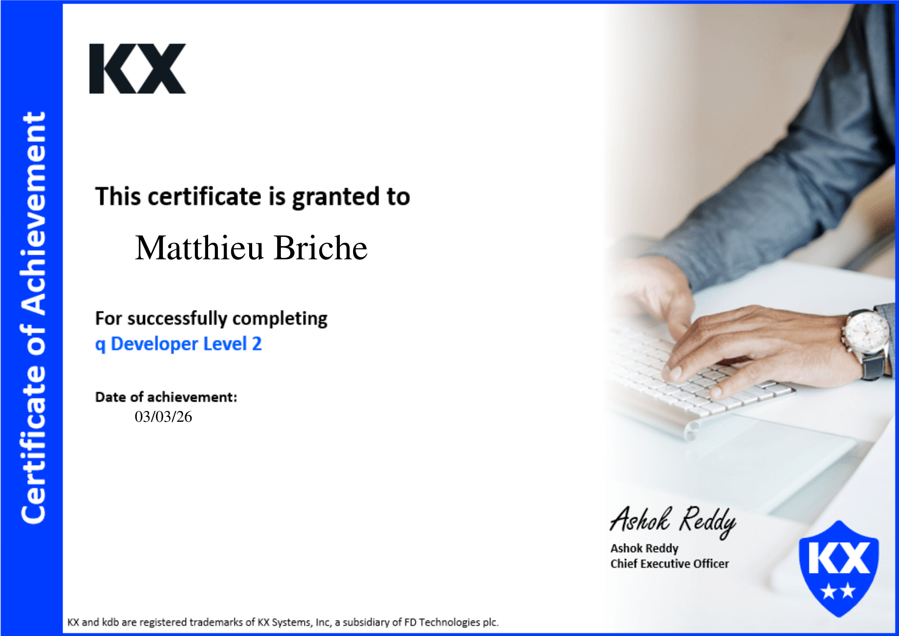
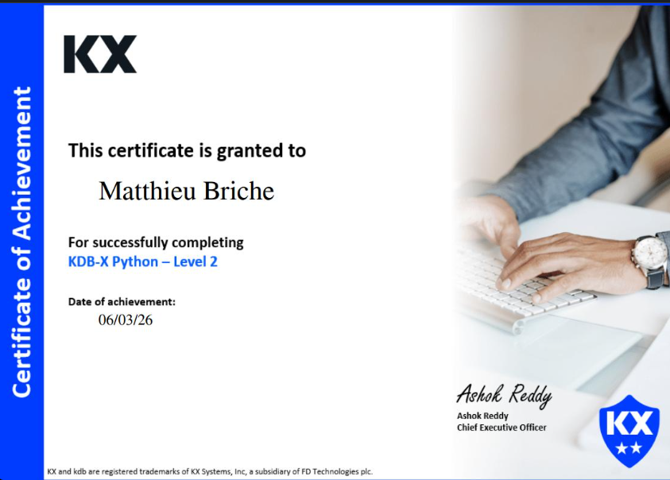
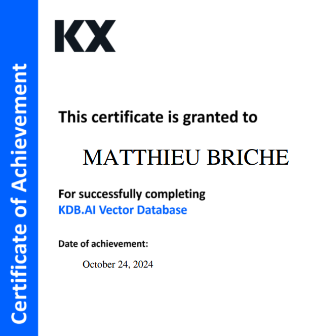
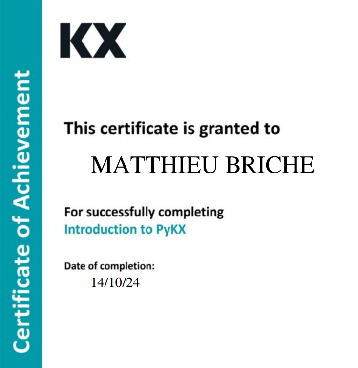

# Hi, I'm Matthieu 👋

**kdb+/q developer & quant data engineer** — tick data, market microstructure, derivatives pricing.

- 🎓 **Executive Program in Financial Engineering — Sorbonne Université** (Nov 2026 – Jul 2027): stochastic calculus, Monte Carlo methods, high-frequency trading & microstructure, machine learning
- 💼 10 years in data & pricing, 5 of them in financial markets: OTC operational risk at **Société Générale**, gas forward pricing on an **energy trading desk**
- 🏅 **KX certified**: q Developer Level 2 · KDB-X Python Level 2 (+ KDB.AI Vector Database and PyKX courses)
- 🔎 **Open to** an internship / part-time role in capital markets or commodities — Paris, Mon–Thu, from November 2026

---

## Featured projects

**[Real-time tick platform & dashboard](https://github.com/matthieu-briche/kdb-realtime-tick-dashboard)** · q · [▶ live demo](https://matthieu-briche.github.io/kdb-realtime-tick-dashboard/web/index.html?demo) 
kdb+tick written from scratch (feed, TP, RDB, RTE, HDB, gateway) with a live trading dashboard over WebSocket and KX Dashboards. 
→ No data loss (TP log replay on restart) · automatic EOD to a partitioned HDB · dashboard queries in O(symbols), not O(ticks)

**[Day-ahead power price forecasting](https://github.com/matthieu-briche/power-price-forecasting)** · Python 
German power market (DE-LU) on real data: ridge and gradient boosting vs the naive EPF benchmark, walk-forward back-test, forecasts valued through a battery trading strategy. 
→ Gradient boosting halves the naive error (rMAE 0.53) · ridge captures 98% of perfect-foresight PnL: lowest error ≠ highest PnL

**[Hawkes quote simulator](https://github.com/matthieu-briche/kdb-hawkes-quote-simulator)** · q 
Clustered quote arrivals simulated fully vectorised in q, MLE calibration (O(n) log-likelihood, Nelder–Mead), partitioned HDB and tickerplant replay. 
→ ~530k quotes/day · 95% CI coverage of 94% / 96% / 92% for (μ, α, β) over 50 fits

**[Fixed-income tick stack](https://github.com/matthieu-briche/fi-algo)** · q, TorQ 
TorQ pipeline fed by government bonds on Ornstein–Uhlenbeck yield curves, with a fixed-income library in q (cash flows, price/yield, duration, DV01) and real-time risk. 
→ 12 benchmarks (UST, Bunds, OATs) · qspec tests in CI

**[Options pricer](https://github.com/matthieu-briche/python-options-pricing)** · Python 
European, Asian and American options with Greeks: closed form, Monte Carlo, Longstaff–Schwartz, SVI smile calibration, hedging back-tests; validated against QuantLib. 
→ 94.3% of a real AAPL option chain repriced within the bid–ask spread · 233 tests

**[Tick-data analytics platform](https://github.com/matthieu-briche/kdb-q-tick-data-analytics)** · q, PyKX 
Full tick stack driven from Python, fed by Hawkes-simulated quotes; gateway APIs for OHLC bars (`xbar`), slippage to mid (`aj`) and realised volatility. 
→ Compressed HDB of 6.4M rows · query-tuning benchmarks

**[Execution quality & TCA](https://github.com/matthieu-briche/kdb-execution-quality-tca)** · q · KX Academy capstone 
Best-execution, slippage and markouts (1 s to 5 min) via `aj`; broker and venue scorecards; outlier detection with `fby`. 
→ 10,000 executions vs ~157k NBBO updates (5 brokers, 4 venues)

### Validation, not just code
Hawkes fits checked by the **time-rescaling theorem** (KS test), autocorrelation and **Fano factor** · options pricer benchmarked against **QuantLib** and real market quotes · power forecasts tested **walk-forward** with leakage tests · test suites run in **CI** (qspec for q, pytest for Python).

---

## Certifications

  
  
  
  

**q Developer Level 2** (Mar 2026) · **KDB-X Python Level 2** (Mar 2026) · KDB.AI Vector Database (Oct 2024) · Introduction to PyKX (Oct 2024)

---

## Tech stack

**kdb+/q** · qSQL · as-of joins · IPC · tick architecture · attributes & query optimisation · TorQ · PyKX

**Python** (pandas, NumPy, pytest, scikit-learn, Prophet) · **SQL** · R · BigQuery · ETL pipelines · Git · Linux · Bash · MongoDB · Docker

**Quant**: Black–Scholes · SABR · short-rate models (CIR, OU) · Hawkes processes · maximum likelihood · Monte Carlo · stochastic calculus · vanilla derivatives (swaps, options, forwards)

---

## Background

- **M2 Applied Mathematics & Quantitative Finance** — Université de Lille, 2016 · thesis: simulation of fractional Brownian motion and Hurst exponent estimation
- **Data engineer**, fuel distribution group (23 subsidiaries, 150 stations) — sales forecasting engine in Python, daily price & volume time series
- **Gas pricing analyst**, energy trading — multi-maturity forward pricing models (month / quarter / semester) with Reuters market data, daily P&L and position reporting

📚 Currently reading: *Q Tips* (Psaris) · *Algorithmic and High-Frequency Trading* (Cartea) · *Trades, Quotes and Prices* (Bouchaud)

---

📫 [LinkedIn](https://linkedin.com/in/matthieu-briche-aa69b441)
